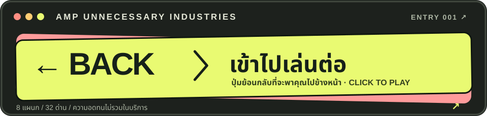

[](https://ampsoria.github.io/Amp-Useless-Web/)

# AMP. — กรมบริการขัดใจ

> ออกแบบผิดหลักอย่างตั้งใจ · เล่นได้จริงอย่างน่าเสียดาย

**8 แผนก · 32 ด่าน · 0 เหตุผลที่ปุ่ม Back ควรพาไปข้างหน้า**

ยินดีต้อนรับสู่จักรวาลธุรกิจที่ทุกแผนกพร้อมให้บริการ แต่ระบบไม่ค่อยพร้อมให้ความร่วมมือ เลือกหมวด เล่นมินิเกม ผ่านด่านที่ค่อย ๆ ขัดใจขึ้น และพยายามรักษาความสัมพันธ์กับเมาส์ของคุณไว้ให้ดี

**[↗ เข้าไปเล่นเลย](https://ampsoria.github.io/Amp-Useless-Web/)** — ถ้าปุ่มใหญ่ด้านบนดูน่าสงสัย ปุ่มนี้ก็น่าสงสัยเหมือนกัน แต่ไปที่เดียวกัน

## แผนกที่เปิดให้รบกวน

| แผนก | เราให้บริการ | สิ่งที่อาจเกิดขึ้น |
| --- | --- | --- |
| **Amp Shop** | ซื้อของที่ไม่จำเป็น | ตะกร้าพิจารณาความสัมพันธ์กับสินค้า |
| **Amp Bank** | โอนเงินศูนย์บาท | ยืนยันตัวตนจนลืมว่าตัวเองเป็นใคร |
| **Amp Travel** | เดินทางแบบอ้อม | ถึงจุดหมายที่ไม่ใช่จุดหมาย |
| **Amp Corporate** | ประชุมเพื่อหาว่าประชุมเรื่องอะไร | ทุกฝ่ายเห็นชอบให้เพิ่มสไลด์ |
| **Amp Academy** | เรียนรู้วิธีเริ่มเรียน | ได้ใบรับรองการตอบข้อสอบ |
| **Amp Arcade** | เล่นเกมกับ UI ที่โกง | บอสเขียนกติกาเอง |
| **Amp Hospital** | รอเพื่อรับสิทธิ์ในการรอ | คิวปัจจุบันอาจเป็นเมื่อวาน |
| **Amp Dating** | แมตช์กับคนและปุ่ม | เข้ากันได้ 99% เพราะยังไม่ปิดแอป |

แต่ละแผนกมี **4 ด่านและกติกาเฉพาะตัว** ผ่านได้จริงทุกด่าน แม้ว่าระบบอาจแสดงความผิดหวังเมื่อคุณทำสำเร็จ ความคืบหน้าบันทึกไว้ในเบราว์เซอร์ของคุณ

## คู่มือการใช้งานที่อาจช่วย

1. เลือกแผนกที่ดูไว้ใจได้น้อยที่สุด
2. อ่านโจทย์ แล้วสงสัยว่าทำไมปุ่มถึงอยู่ตรงนั้น
3. ถ้าติด ใช้คำใบ้ได้ ระบบจะช่วยด้วยท่าทีไม่เต็มใจ
4. ผ่านครบ 4 ด่าน แล้วไปแผนกอื่นเพื่อหงุดหงิดต่อ

> **ประกาศจากฝ่ายบริการ:** ปุ่มที่เขียนว่า “Back” อาจพาคุณไปหน้าถัดไป เราถือว่าได้แจ้งแล้ว

## รันเองในเครื่อง

จากโฟลเดอร์ `amp-site`:

```sh
python3 -m http.server 4173 --directory dist
```

เปิด `http://localhost:4173/` ในเบราว์เซอร์ ไม่ต้องติดตั้งแพ็กเกจ และไม่ต้องกรอกแบบฟอร์ม 17 หน้าเพื่อเริ่มเล่น

## เพิ่มแผนกหรือด่านในอนาคต

| ไฟล์ | หน้าที่ |
| --- | --- |
| [`dist/content.js`](./dist/content.js) | ชื่อแผนก คำโปรย โจทย์ คำใบ้ มุก และฉากจบ |
| [`dist/experiences.js`](./dist/experiences.js) | ฉากและกติกาเฉพาะแผนก |
| [`dist/experiences.css`](./dist/experiences.css) | หน้าตาของแต่ละแผนก |
| [`dist/app.js`](./dist/app.js) | หน้ารวม เส้นทาง ความคืบหน้า และการผ่านด่าน |

แผนกใหม่ต้องมี 4 ด่านและ 4 คำใบ้ พร้อมฉากที่รองรับด่าน 0–3 ใน `experiences.js` ความคืบหน้าของผู้เล่นใช้ `localStorage` คีย์ `amp-progress-v1`; อย่าเปลี่ยนคีย์นี้ถ้าไม่อยากให้ระบบทำเป็นจำผู้เล่นไม่ได้

## เผยแพร่

ไฟล์ใน `dist/` เผยแพร่ผ่าน [GitHub Actions](./.github/workflows/pages.yml) ทุกครั้งที่ push ไปที่ `main` เปิด **Settings → Pages → Build and deployment → Source: GitHub Actions** ในรีโปนี้ก่อนใช้งานปุ่มเข้าเล่นด้านบน

---

<sub>© AMP UNNECESSARY INDUSTRIES — หากคุณงง แสดงว่าการออกแบบประสบความสำเร็จ</sub>
